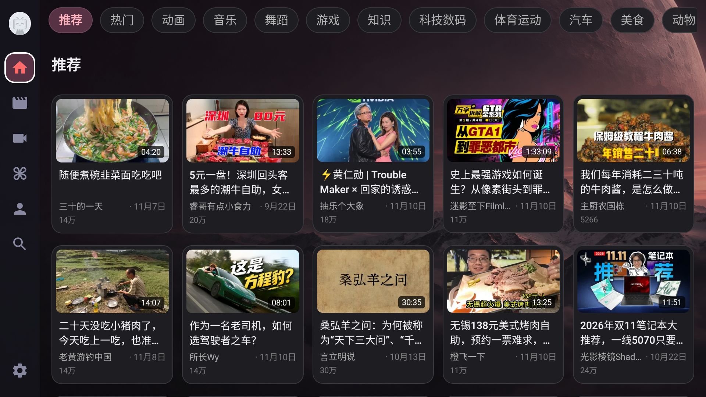
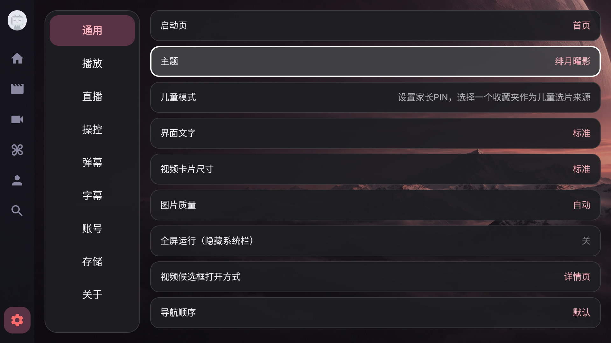
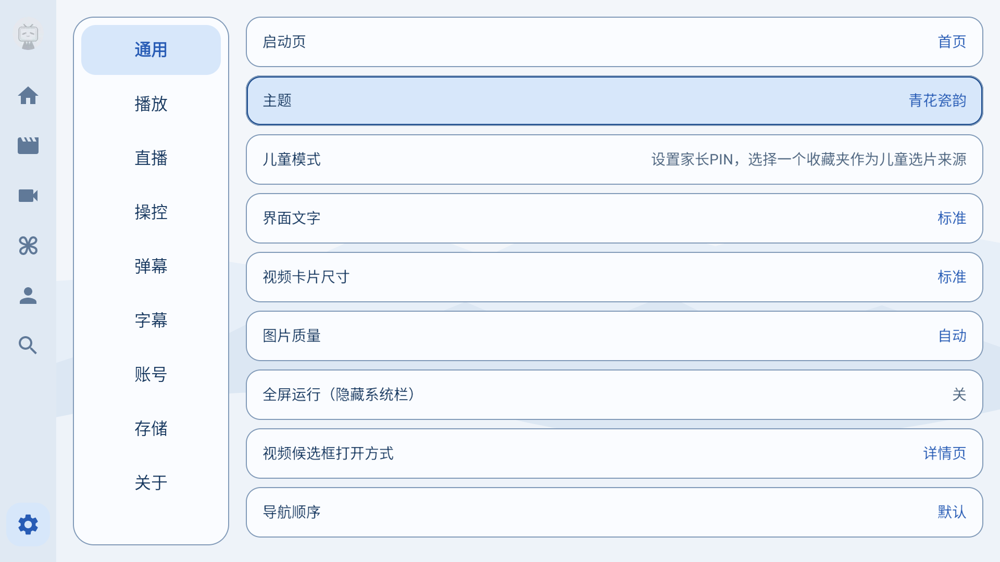
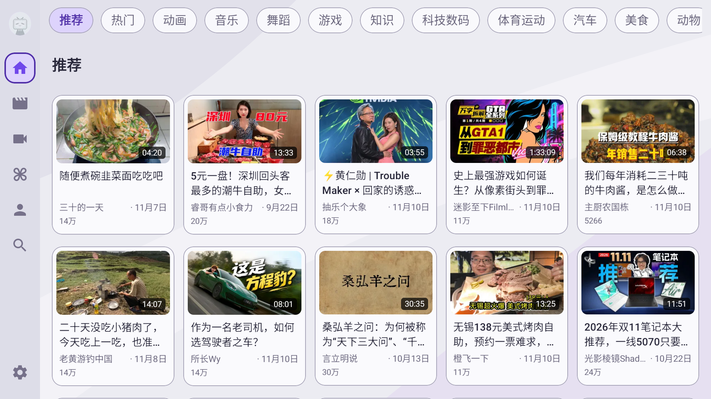
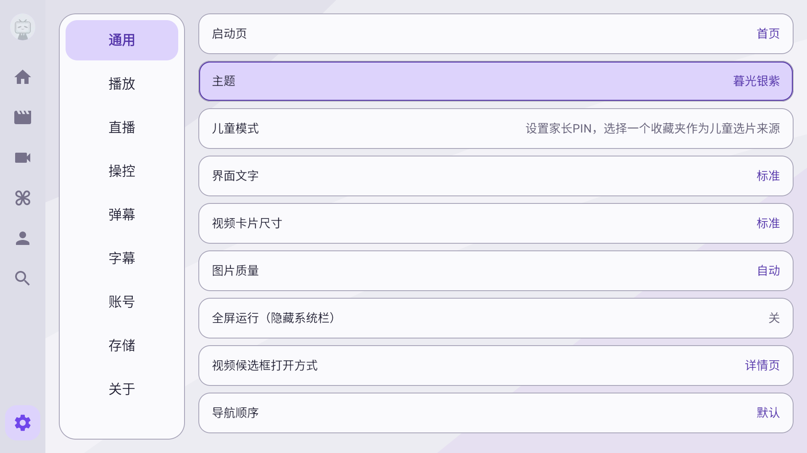
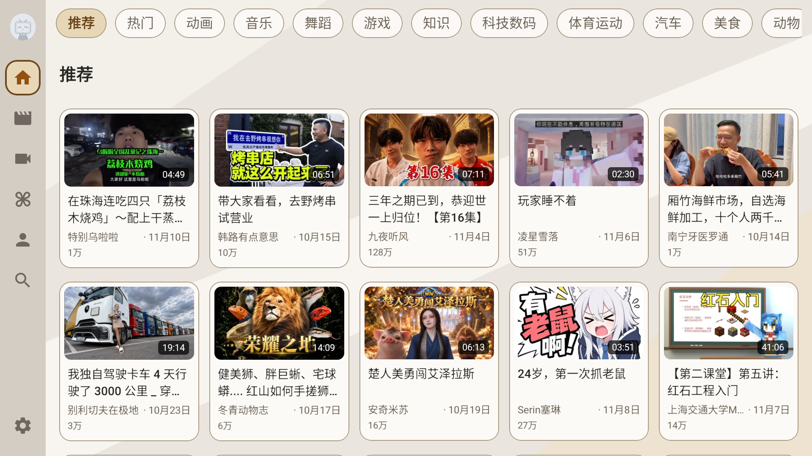
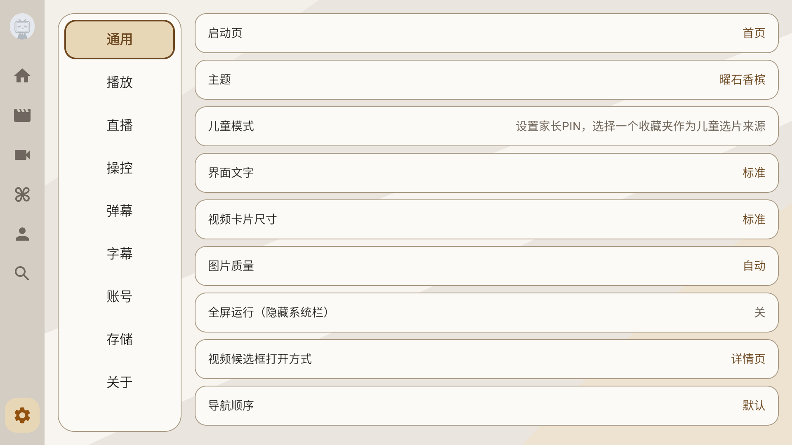

  

# BLBL-ZD

面向 Android 电视、电视盒子的非官方哔哩哔哩客户端项目，支持遥控器操作和触摸操作。主要用于个人学习、Android TV 交互研究与个人设备测试。
An unofficial Bilibili client project for Android TVs and TV boxes, supporting both remote control and touch operations. It is primarily intended for personal learning, Android TV interaction research, and personal device testing.

**本仓库是安装包发布与问题反馈仓库，仅提供编译后的 APK、版本说明及界面预览，不上传应用源代码，也不作为源码开源仓库。**

[下载安装包](https://github.com/cwe88108/BLBL-ZD/releases) · [查看V1.1.5正式版说明](https://github.com/cwe88108/BLBL-ZD/releases/tag/v1.1.5) · [反馈问题](https://github.com/cwe88108/BLBL-ZD/issues)

**本项目与哔哩哔哩及其运营主体不存在隶属、合作、代理或官方授权关系。** 项目名称、界面预览及功能描述不表示获得平台或内容权利人的认可。需要稳定服务、完整权益或官方支持时，请使用平台官方产品。

当前说明对应 **正式标准版1.1.5** 与 **兼容测试版1.1.5-android5-7**（versionCode均为115），更新日期：2026-11-12。**V1.1.5为正式Release，不标记为Pre-release。** 兼容包仍缺少真实Android5～7设备验收；正式发布状态不代表所有设备和异常场景均已通过验证。

[查看V1.1.5更新与已知限制](https://github.com/cwe88108/BLBL-ZD/releases/tag/v1.1.5)；[V1.1.0预发布版](https://github.com/cwe88108/BLBL-ZD/releases/tag/v1.1.0)、[V1.0.90](https://github.com/cwe88108/BLBL-ZD/releases/tag/v1.0.90)及其他历史版本继续保留。

## V1.1.5 正式版更新

相对公开的V1.1.0预发布版，汇总V1.1.1～V1.1.5的画质、详情预加载与HDR兼容修复。保留现有四套主题和遥控器界面。

- **统一清晰度目录与真实画质状态**：默认设置与播放器共用档位，保留8K、HDR、高帧率及服务端合法新档位；当前视频只展示平台实际提供的信息。目标档位与实际输入、首帧确认、显示输出分别表达。
- **修复默认4K落到1080P60**：已保存的具体清晰度不再被固件漏报的1080P自动显示上限覆盖。明确设置的最高1080P/最高4K上限仍有效；编码作为同档偏好，保留解码能力、HDR、账号与片源限制。
- **详情页播放预加载**：新增关闭、智能、增强模式，进入当前详情后进行有预算的准备，正式播放时复用。计费网络、低内存、后台、账号或儿童授权变化时按策略降级或取消；未点击播放不写观看历史、不出声。
- **修复20分钟位置续播接管**：按有效续播锚点准备和构建媒体源，修复把绝对时间误作缓冲时长、先从0秒构建再跳转导致准备失效的问题。
- **HDR兼容回退更准确**：杜比显示条件不满足时，优先使用片源提供、解码能力已确认且尺寸/帧率合适的HDR10/HLG轨道；仍遵守固定上限及优先SDR设置，不把杜比源改名冒充HDR。
- **区分盒子解码和电视显示能力**：显示HDR列表为空时，HDR10/HLG可在播放设置中确认“本次兼容试播”后手选。杜比视界仍要求显示端支持，不加入强制杜比或未经验证的隧道策略。
- **兼容分支同步**：补齐Android5～7的显示接口、儿童模式安全存储等兼容处理，保留旧引擎；兼容版仅进行描述信息准备，不启用标准版的媒体队列或准备态播放器预热。

标准版已在Android11盒子验证保存默认4K后的3840×2160输入、真实4K HDR10与HDMI HDR10状态、20分钟续播准备接管。最终HDR回退相关回归标准版365项、兼容分支378项零失败；这不是全部功能、全部设备的覆盖证明。预加载效果取决于详情停留时间、网络、编码和设备，不承诺所有页面或资源提速50%。

**电视能力示例**：Sony KD-55X8000G支持HDR10/HLG，其HDMI不支持杜比视界；盒子有杜比解码器也不能补出电视端能力。[索尼官方兼容表](https://support.sony.jp/electronics/support/articles/00161421)。真实8K约30fps和4K HDR约60fps有有限设备验证，不等于8K60或跨设备杜比输出认证。

## 历史更新：V1.1.0

本版汇总V1.0.91～V1.0.92的电视界面与主题优化，并将两分支统一到1.1.0系列。

| 主题 | 色彩方向 |
|---|---|
| 绯月曜影 | 原深色主题，暗夜山景与粉色强调 |
| 青花瓷韵 | 瓷白、淡蓝灰与青花蓝 |
| 暮光银紫 | 雾银、浅紫与鸢尾紫 |
| 曜石香槟 | 珍珠白、暖灰与深琥珀 |

切换入口：**设置 → 通用 → 主题**。三套浅色主题的文字、卡片、按钮和遥控焦点分别适配；个人中心与点播/直播控制条补齐主题颜色。原跟随系统及经典选项保留，视频内容和封面不作主题滤色。

累计修复大字号下发布日期省略、部分弹窗和列表适配，以及“我的”返回刷新将追加列表截回第一页的问题。今日推荐横幅和顶部固定品牌栏按需求删除。性能目标与完整设备矩阵仍未完成，不作“提速一倍”等承诺。相对最终V1.0.92主题修复包，V1.1.0仅升级版本信息，运行时DEX和原生库保持一致。

## 界面预览

下列8张为电视盒子1920×1080原始截图，未用AI换色或修图。采集包为V1.0.92主题修复版，作为V1.1.0四主题的历史预览保留，**不是V1.1.5新增功能截图**。展示首页与通用设置；不公开含真实账号资料的个人中心和最近搜索截图。截图不代表全部设备或功能已完成验收。

### 绯月曜影

<table><tr><td width="50%"><strong>首页</strong> </td><td width="50%"><strong>通用设置</strong> </td></tr></table>

### 青花瓷韵

<table><tr><td width="50%"><strong>首页</strong> </td><td width="50%"><strong>通用设置</strong> </td></tr></table>

### 暮光银紫

<table><tr><td width="50%"><strong>首页</strong> </td><td width="50%"><strong>通用设置</strong> </td></tr></table>

### 曜石香槟

<table><tr><td width="50%"><strong>首页</strong> </td><td width="50%"><strong>通用设置</strong> </td></tr></table>

截图中的视频封面、标题、头像及商标等属于相应权利人；展示不构成对这些内容的再利用授权。如权利人认为展示不适当，可通过本仓库Issue提出删除或替换请求。

## 功能概览

| 模块 | 当前提供的功能 |
| --- | --- |
| 首页 | 推荐、热门与分区浏览；视频卡片展示作者、发布日期等信息；重复确认当前侧栏栏目可刷新内容 |
| 视频详情 | 视频信息、作者入口、评论入口、右侧推荐卡片；窄屏使用上下布局 |
| 视频播放 | 播放/暂停、进度调整、长按连续快进/快退、分P与播放队列；清晰度、编码、倍速和画面比例等设置 |
| 播放设置 | 适配遥控器的侧边设置面板；区分当前播放设置和设备默认偏好；字幕、音轨等选项取决于内容是否提供 |
| 弹幕 | 多轨滚动、防重叠、透明度/字号/速度、屏蔽规则；顶部1/8、1/4、1/2、3/4或全屏显示区域 |
| 直播 | 分类与二级分类、房间列表和直播播放；服务端可用的画质/线路选择、画面比例和弹幕区域设置 |
| 动态与我的 | 视频动态、观看历史、收藏及稍后再看等入口；账号相关内容需要登录并具有相应权限 |
| 搜索 | 视频、番剧、影视、UP主、直播间及主播等分类搜索；单击输入框或遥控器确认可唤起系统输入法 |
| 账号 | 扫码登录、账号切换和退出登录入口 |
| 全局设置 | 通用、播放、直播、操控、弹幕、字幕、账号、存储和关于；设置备份/恢复及范围恢复默认等入口 |

以上是当前实现范围，不是功能永久可用或与官方客户端完全一致的承诺。平台接口变化、账号状态、地区限制和系统能力均可能影响结果。

### 历史更新：V1.0.90 相比 V1.0.73

本次包含 **V1.0.74～V1.0.90** 的新增功能与优化，标准版和兼容测试版同步到 V1.0.90。

#### 新增功能

- **儿童模式**：在“设置 → 通用 → 儿童模式”中开启。登录后由家长设置6位PIN、选择一个允许观看的收藏夹，进入受限浏览与播放界面；退出及家长设置需要PIN验证。不是自动内容分级或平台级家长控制，收藏夹内容仍需家长自行选择。
- **个人信息中心**：已登录时点击左侧头像，可查看关注/粉丝、近期关注博主及追番/追剧订阅信息，进入订阅列表、刷新数据或确认退出；未登录时仍进入扫码登录。
- **播放中直达博主空间**：普通视频控制条新增圆形博主头像，可用遥控器或触摸进入作者的视频列表，跳转前暂停当前播放。
- **观看历史同步**：登录账号播放后，按实际播放进度向平台提交观看记录；暂停、离开及结束时补交进度，返回“我的 → 历史”时刷新列表。游客不提交，网络失败不阻断播放，也不承诺强制结束进程前的记录一定已上传。
- **HDR本次兼容试播**：针对设备显示能力报告不完整的情况，提供用户主动开启的本次试播入口，默认关闭、进入新视频后重置；不更改系统HDR设置，失败仍按恢复策略处理。

#### 播放稳定性与高规格视频优化

- **更有依据地选择播放源**：结合编码、分辨率、帧率、设备解码与显示能力选择画质，改进手动高规格选源及当前选择状态显示；能读取到的实际输入信息才用于判断，不把菜单中的“4K/8K/HDR”当作实际输出证明。
- **改进颜色识别与兼容回退**：需要恢复时，按需识别媒体初始化信息，改善HDR/SDR判断及候选选择；信息不足时保留“未知”，避免把未知来源误判为SDR。
- **反复缓冲有限恢复**：检测短时间内多次缓冲，并结合实际吞吐和可用候选，在条件满足时尝试一次较低码率恢复；保留进度与暂停意图，不无限重试、不自动改写全局默认画质。
- **改善播放器重建后的恢复**：优化重播、页面/播放器重建与焦点恢复，减少返回后焦点错位和播放状态衔接问题。

#### 遥控器与电视界面优化

- **播放设置更紧凑**：使用半宽侧边面板，减少重复说明；设置名称和当前值按实际宽度适配，避免省略和溢出。V1.0.90最终将文字高度上限设为功能项行高的60%，保持原行高与间距。
- **控制条按空闲时间隐藏**：默认3秒；遥控器按住或连续操作时保持显示，最后松键后重新计时。设置等交互面板打开时保持可见，直播同步优化。
- **控制条与头像布局统一**：电视端采用更紧凑的控制条；博主头像与同排按钮等高、所在区域等宽并居中，减少对视频画面的遮挡。
- **电视列表与焦点修复**：修复直播首次加载未从首行显示的问题；改善进入详情、从播放返回详情时的焦点恢复，以及电视详情页相关视频卡片的排列和滚动。
- **桌面横幅修复**：调整电视桌面图标/横幅的缩放与布局，改善部分启动器上的裁切、缩小及留白问题。

#### 兼容版同步与验证边界

- 独立兼容版同步上述业务改动，保留Android5～7的依赖、显示接口与加密登录保存适配；同签名旧兼容版可覆盖升级，与标准版仍独立安装。
- 标准版的部分播放、账号读取、历史同步及设置布局已有设备实测；兼容分支构建与测试报告汇总1135项零失败，包含缓存及UP-TO-DATE任务。**本次兼容包未做Android5～7真机验收**。
- HDR、4K/8K及高帧率效果取决于片源、账号权限、设备解码和显示链路；部分设备上的有限时长验证不代表所有设备支持，8K60及跨厂商长时间场景仍待验证。
- 部分设备的系统MENU键仍待专项兼容核查，可使用屏幕控制条中的设置入口。儿童模式的账号过期、收藏夹权限变化、长时间播放及系统恢复等异常组合仍需继续验收。

## 系统要求与安装

| 版本 | 适用系统 | 下载 |
| --- | --- | --- |
| 正式标准版 1.1.5 | Android 8.0 及以上（API 26+），新设备优先使用 | [标准版 APK](https://github.com/cwe88108/BLBL-ZD/releases/download/v1.1.5/BLBL-ZD-1.1.5-release.apk) |
| 兼容测试版 1.1.5-android5-7 | 面向 Android 5.0～7.x（最低 API 21），旧系统运行验收尚未完成 | [兼容版 APK](https://github.com/cwe88108/BLBL-ZD/releases/download/v1.1.5/BLBL-ZD-1.1.5-android5-7-release.apk) |

| 安装包 | SHA-256 |
|---|---|
| 标准版 1.1.5 | `58ccbb26c60884563a867c2874d5ccd8e0fc13ef3e762ac9bc22077a9f347d77` |
| 兼容版 1.1.5-android5-7 | `60fea443d0d218a95c37a901529ef687d7ad1f589f02b74dd3e97eaf6b3b4e33` |

**两个版本均不支持 Android 4.4。** 本次兼容版已完成编译、测试与正式签名核验；本次未做真机安装验收，历史Android14平板结果不代表本版本或Android5.0～7.x已通过实际运行验收。兼容版保留现有业务模块，旧设备上的视频/直播解码、遥控器及网络表现仍需验证。APK 包含 32 位 ARM、64 位 ARM、x86 和 x86_64 原生库。

兼容版显示名称为“BLBL-ZD 兼容版”，包名为 `com.example.bilitv.legacy`，与标准版独立安装。两者登录、设置及本地记录分别保存，不能通过覆盖标准版迁移数据。
- 主要面向横屏电视和电视盒子，也支持横屏平板；建议配合方向键、确认键、返回键使用。
- 需要联网。高分辨率、高帧率、HDR及不同编码的播放效果取决于内容、账号权限、网络和设备解码能力。

发布的安装包请从 **[本仓库 Releases](https://github.com/cwe88108/BLBL-ZD/releases)** 获取，并核对该发布附带的 SHA256 校验值；仓库没有发布对应文件时，不代表其他渠道的同名文件由本项目提供。标准版和兼容测试版均在 V1.1.5 正式Release 中提供，请按系统版本选择附件。本次仅附两个APK，校验值列在Release说明及本README。

1. 下载与目标设备系统相符的正式 APK，通过设备安装器安装。
2. 如系统提示，按需允许本次安装来源；无需为本项目关闭系统安全保护或授予 Root 权限。
3. 启动后可先浏览公开内容；需要账号功能时，再按界面提示扫码登录。不要向任何人提供账号密码或会话凭据。

同包名、同签名且版本号允许时，可覆盖升级。此前安装的测试包、调试包或其他渠道的同名包可能采用不同签名；签名不一致时不能直接覆盖。卸载会清除本机应用数据，操作前请自行确认需要保留的设置。

## 遥控器操作

| 操作 | 说明 |
| --- | --- |
| 方向键 | 在导航、视频卡片和设置项之间移动焦点 |
| 确认键 / OK | 激活当前按钮或卡片；输入框获得焦点后，确认可唤起系统输入法 |
| 返回键 / BACK | 关闭当前面板、返回上一级；播放页会结合当前控制栏/弹窗状态处理返回 |
| 菜单键 / MENU | 在播放页打开播放设置；没有菜单键时可使用屏幕控制栏的设置入口 |
| 播放页左右键 | 在进度操作状态下快退/快进，长按可连续调整；设置面板内按面板提示操作 |

直播与点播的可用操作不同，直播不提供点播式进度拖动。不同遥控器的按键上报和系统输入法行为可能不同，请以界面提示为准。

## 使用边界与权利说明

### 平台、内容与商业权益

本项目提供客户端界面和交互实现，不运营视频内容平台，不托管或售卖节目内容，也不提供平台会员、账号或播放权益。

- 使用前请阅读并遵守[哔哩哔哩用户使用协议](https://www.bilibili.com/protocal/licence.html)、相关服务规则、适用法律法规及内容版权要求。项目公开不表示已获平台接口使用或第三方商业运营授权。
- 尊重平台、创作者及其他权利人的合法权益。不得利用本项目绕过会员、付费、版权、地域、DRM或其他访问控制；不得将可访问或可播放误认为获得下载、传播、改编或商业使用授权。
- 不得利用本项目进行批量采集、账号滥用、恶意请求、刷量、攻击或其他干扰平台正常运营的行为。功能失败时，不应通过持续高频重试或规避风控方式强行访问。
- 项目面向个人学习与设备测试，不提供商业使用授权。请勿将本项目包装成官方产品，或用于售卖会员/账号、收费代装、商业预装、引流获利等可能侵害第三方权益的活动；不要在平台官方账号评论区刷屏宣传。
- 高画质、音轨、字幕及付费内容的可用性由服务端和合法账号权益决定。本项目不作“免费解锁”“永久可用”“全内容可看”等承诺，不替代官方客户端、会员服务或创作者的商业渠道。

“学习研究”“个人使用”或本说明本身均不构成豁免，也不能消除实际行为产生的法律责任。开发者、分发者及使用者仍应各自履行适用义务；本说明不免除任何依法应承担的责任。

### 账号与隐私

登录和账号操作涉及会话凭据。应用会在设备上保存登录会话、偏好及本地观看记录等数据；访问内容、获取账号资料或执行收藏等操作时，会与相应平台服务通信。

不要在 Issue、截图、日志或公开仓库中提交登录二维码、Cookie、SESSDATA、bili_jct、Token、完整播放地址、账号资料或签名密钥。诊断信息提交前请自行检查并脱敏。公共或转让设备上使用后，应退出登录并清理应用数据；必要时在官方账号安全中心管理会话。

### 权利反馈

如平台、创作者或其他权利人认为安装包、应用功能、描述或截图涉及其合法权益，请通过[本仓库 Issues](https://github.com/cwe88108/BLBL-ZD/issues)说明相关版本/功能、权利依据和具体诉求，避免公开个人证件等敏感材料。维护者可据反馈核查、修改、移除相关内容或暂停分发；请勿将问题提交给被参考项目的维护者。

## 已知限制

- V1.1.5标准版已在电视盒子同签名覆盖安装，完成普通4K、HDR10及相关播放复验；未完成所有机型、实体遥控器、远距离显示及真实断网/硬件故障恢复的完整验收。
- 部分真实字幕请求仍可能返回 HTTP 412，字幕成功加载与全部样式尚未验收；画面内嵌字幕不受该字幕轨道接口控制。
- 部分盒子没有系统文件选择器。设置导入/导出目前缺少该组件启动失败的保护，可能异常退出；这类设备请暂不使用这两个入口。
- 密集弹幕、不同实际音轨、高音质及播放队列等组合仍需持续真机验证；真实投币、关注等写入未在本轮验收。
- 兼容版是面向 Android 5.0～7.x 的独立兼容测试版，本版本已完成构建、测试和正式签名检查，本轮未做设备验收，**尚未在真实 Android 5.0～7.x 设备上验收**。
- **屏保打断播放的修复尚未在索尼、TCL 等具体电视上完成跨屏保等待阈值的现场长时间验收**；电视自身的 HDMI 待机、无操作关机或面板保护策略不受应用控制。
- 历史版本的详情页 / 首页 / 筛选面板焦点改动已有电视盒子实测记录；低内存电视的回收恢复场景待验证，Android 5–7 兼容版未做真机验收。
- 接口与播放权益由平台、合法账号和设备能力决定，不承诺绕过付费、地域、DRM或其他访问控制。

- 当前版本仍在持续完善，尚未完成所有设备、实体遥控器和异常恢复场景的验收。
- 接口、登录、推荐、分区和直播结果可能变化或暂时不可用；部分列表可能采用推荐快照，不代表平台全部内容。
- 高画质选项存在不代表服务端已提供对应源；切换结果以实际返回的播放源和界面状态提示为准。
- 字幕和音轨依赖视频本身提供的数据；没有可用数据时，不会因为修改偏好而生成额外字幕或音轨。
- 关于页“检查更新”读取本仓库Release并提示下载；不会自动静默安装。也可自行查看[本仓库 Releases](https://github.com/cwe88108/BLBL-ZD/releases)。

## 仓库发布范围

本仓库公开的内容包括：

- Releases 中编译并签名的 APK；V1.1.5仅附两份APK，SHA-256列于Release说明及本README。V1.0.90等历史附件继续保留。
- README、版本变更说明、使用说明和界面截图。
- Issues 中经过脱敏的问题反馈。

应用源代码、开发工程、内部测试资料、签名私钥、账号数据及未经脱敏的诊断记录不在本仓库的公开范围内。GitHub 自动生成的 “Source code (zip/tar.gz)” 仅是本发布仓库对应提交的归档，不包含未上传的应用源代码，也不表示应用已开源。

## 反馈问题

通过[本仓库 Issues](https://github.com/cwe88108/BLBL-ZD/issues)提交应用版本、设备型号、Android版本、遥控器类型、复现步骤、预期结果和实际结果；必要时附上已脱敏截图或日志。请勿提交包含账号凭据的原始诊断文件。

与官方账号权益、内容授权或会员购买有关的问题，请通过平台官方渠道处理。本项目不代办相关服务，也不保证第三方接口行为。

## 参考与致谢

本项目的交互研究与文档编写参考了以下项目的公开资料：

- [cat3399/blbl](https://github.com/cat3399/blbl)：Android客户端界面组织、遥控器与触摸操作思路，以及公开项目的使用边界说明。
- [chinasoul/BT](https://github.com/chinasoul/BT) 及其[发布说明](https://github.com/chinasoul/BT/releases)：Android TV使用场景、播放器设置和功能变更说明方式。
- [xiaye13579/BBLL](https://github.com/xiaye13579/BBLL)、[aaa1115910/bv](https://github.com/aaa1115910/bv)：电视客户端交互设计参考。
- Android、Kotlin、Jetpack Compose、Media3、Room、DataStore、OkHttp及其他依赖项目的维护者。

上述链接仅说明参考来源，不表示原作者参与维护、为本项目背书或授予额外权利。第三方代码与资源的使用应分别遵守其许可要求；致谢不能代替许可证、署名或授权义务。

## 软件与第三方权利

本仓库公开安装包，不公开应用源代码，也不以开源许可证授权本应用。能够下载 APK，不等于获得修改、重新打包、再分发或商业使用的授权；需要超出个人设备测试范围使用时，应先核实相应权利与许可。

本说明仅表达本项目的发布范围，不改变任何第三方代码、依赖、素材、内容或商标的原有权利。安装包分发仍应履行所使用第三方组件的许可要求，包括适用的署名、许可文本以及源码提供义务；不能仅以“本项目不开源”排除这些义务。相关权利以各自适用许可为准。
